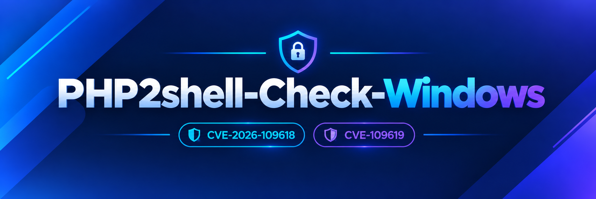
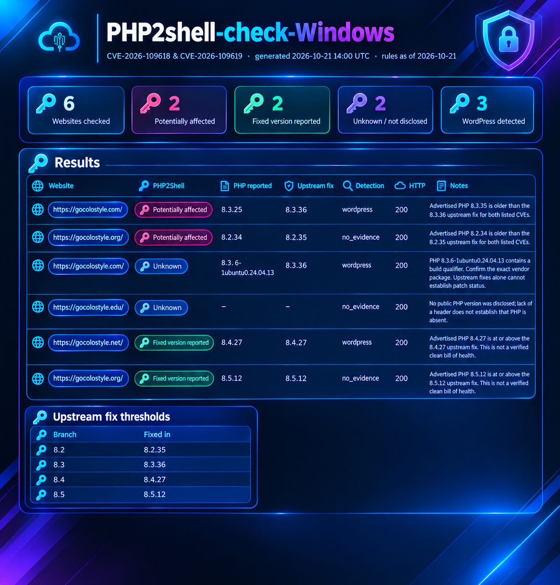

<p align="center">
  
</p>

<p align="center">
  <a href="https://github.com/CompleteTech-LLC/php2shell-check/actions/workflows/tests.yml"></a>
  <a href="https://github.com/CompleteTech-LLC/php2shell-check/releases"></a>
  
  
  <a href="LICENSING.md"></a>
</p>

<p align="center">
  <b>Find websites(wordpress) that advertise a PHP version affected by PHP2Shell</b><br>
  CVE-2026-109618 · CVE-2026-109619 · passive, single-file, dependency-free
</p>

---

php2shell-check inspects only the PHP version a website already publicly discloses in its response headers, cross-referencing it against the official upstream patch for each PHP branch. It sends no exploit payloads, honors robots.txt, and is candid about uncertainty: any hidden or vendor-patched version is reported as unknown — never as "safe".

## Quick start

```sh
git clone https://github.com/CompleteTech-LLC/php2shell-check.git
cd php2shell-check
pip install -r requirements.txt
python wordpress_check.py --input t_websites.txt --format html --output result.html
```

Python 3.10+ on Windows.

## The report

--format html generates a single, fully offline file containing your logo, summary tiles, and every result ranked by risk. It respects the reader's light or dark theme and prints cleanly.

<p align="center">
  <picture>
    <source media="(prefers-color-scheme: dark)" srcset="docs/images/report-dark.png">
    
  </picture>
</p>
<p align="center"><sub>A synthetic example built from reserved <code>example.*</code> domains. <a href="docs/example-report.html">View the HTML report</a>.</sub></p>
Use `--logo path/to/logo.png` and `--brand "Your Company"` to brand reports for your organization. CSV and JSON output remain available for spreadsheets and pipelines.

## What the results mean

| Status | Meaning |
| --- | --- |
| 🔴 `potentially_affected` | The site advertises a plain PHP version below its branch's fix. Ask the administrator to verify. |
| 🟢 `fixed_version_reported` | The advertised version meets the fix — this is not a verified clean bill of health. |
| ⚪ `unknown` | The version is hidden, conflicting, pre-release, vendor-built, or falls outside 8.2–8.5. |

| PHP branch | 8.2 | 8.3 | 8.4 | 8.5 |
| --- | --- | --- | --- | --- |
| **Fixed in** | 8.2.35 | 8.3.36 | 8.4.27 | 8.5.12 |

These thresholds are drawn from the PHP project's advisories for [CVE-2026-109618](https://github.com/php/php-src/security/advisories/GHSA-w8hw-w9fx-j79w) and [CVE-2026-109619](https://github.com/php/php-src/security/advisories/GHSA-6wmf-4rv5-p3rp), verified on 2026-10-21. Because distributions such as [Ubuntu](https://ubuntu.com/security/notices/USN-8948-1) backport fixes without changing the version number, packaged builds are always reported as `unknown`.

> [!IMPORTANT]
> **Potential exposure is not confirmed exploitability.** Headers cannot reveal the PHP SAPI, vendor backports, or actual patch status. Every result should be treated as a prompt for an administrator to investigate.

## How it works

1. Reads `robots.txt` and stops right there if the page is disallowed.
2. Makes just one ordinary `GET` request to the page, with verified TLS and an honest User-Agent.
3. Looks at the `X-Powered-By` and `Server` headers, plus WordPress markers in the HTML.
4. Fetches nothing else — no scripts, admin pages, uploads, or crafted requests.

Only check websites you're authorized to assess, and keep real target lists and results out of version control.

## Agent skill

The [php2shell-check skill](skills/php2shell-check/SKILL.md) guides an agent
through authorized passive checks, report creation, the interpretation of
uncertain results, and the preservation of interrupted runs. It operates
through the existing CLI and contains no separate scanner or runtime
dependencies.

Copy the entire `skills/php2shell-check/` directory into your agent's skill
directory, keeping `SKILL.md` and `agents/openai.yaml` together. For Codex, use
`$CODEX_HOME/skills/php2shell-check/` (normally
`~/.codex/skills/php2shell-check/`) for a personal installation, or
`.agents/skills/php2shell-check/` in the project in which you intend to use it.
Before copying, check for an existing installation so that local edits are
preserved, and reload the agent session if necessary for the skill to be
discovered.

The skill can be installed independently, but running checks still requires
Python 3.10+ and a checkout of this repository or its `wordpress_check.py`
file. It explains how to locate or obtain the checker; do not assume it
resides beside the installed skill. Then ask, for example:

```text
Use $php2shell-check with my local checker checkout to assess the authorized
websites in /path/to/authorized-sites.txt. Save JSON to a new file outside the
repository, summarize the evidence and unknown results, and report the rule date.
```

For agents contributing to this repository, [AGENTS.md](AGENTS.md) contains the
shared development instructions; [CLAUDE.md](CLAUDE.md) points Claude to them.

## Documentation

- [Full reference](docs/REFERENCE.md): every CLI option, output field, and request rule
- [Assessment methodology](docs/PHP2SHELL.md): how each version is classified
- [WordPress free-scan integration](docs/WORDPRESS.md): signed requests, confirmation,
  private job queue, restricted worker, deployment and recovery. **Activation
  requires enforced network egress** (`egress_enforced`); the repository's
  Compose file does not provide it. An explicit `terms_policy` entry for the
  served terms version is also required; without one, the integration remains
  disabled (503) and in-flight jobs stall.
- [Contributing](CONTRIBUTING.md) · [Security policy](SECURITY.md)

```sh
python -m unittest -v      # local-only tests; no external websites are contacted
```
## License
Dual licensed. The project is free under [AGPL-3.0](LICENSE) for research,
education, and open-source use. A [commercial license](LICENSING.md#commercial-license)
is available for closed-source products and hosted services that do not publish
their source. See [LICENSING.md](LICENSING.md) for details. Releases up to v1.0.0
remain under MIT. The CompleteTech LLC name and logo are not covered by either
license; see [BRAND_ASSETS.md](BRAND_ASSETS.md).


