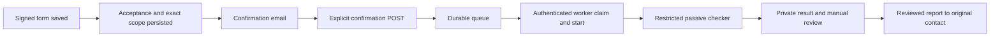

# WordPress free-scan integration

This integration connects a saved, signed CompleteTech free-scan request to a
single passive PHP2Shell check. It consists of the MU plugin in
`integrations/wordpress/`, the Python controller and restricted network adapter
in `integrations/worker/`, and the deployment files in `deployment/`.

The standalone checker retains its existing behavior. Do not expose its CLI
directly to form inputs. The integration checks the website's public homepage
and robots policy; it does not implement the broader manual security review.



## Safety and delivery semantics

- The queue is populated only by the explicit `ct_promo_request_ready` action.
  Editing a post or sending a notification does not start a scan. Old requests
  are not imported. The target, original contact and accepted terms are copied
  into the job rather than read from later edits to request text.
- Confirmation tokens are hashed at rest, short lived, and consumed by an
  explicit POST. GET requests, including email-security prefetches, cannot
  confirm. Mailbox control is not independent proof of domain ownership.
- The confirmation email also carries a separate Stop link, also hashed at
  rest. GET only shows a Stop form; a nonce-protected POST cancels the job
  (`customer_stopped`) under the queue lock. Claims, starts, results and
  request admissions then refuse it (see "Per-request admission"). A request
  already admitted when the Stop is recorded may finish within its ten-second
  timeout; no further request is admitted. Stopping a finished job changes
  nothing and does not block its report. Schema 2 added `stop_token_hash`;
  upgrades run automatically on `init`.
- Jobs have atomic claims. A claim that was never started can be recovered;
  a started job with an uncertain outcome is not automatically scanned again.
  A lost result acknowledgement retries the stored receipt, not the scan.
- The adapter pins each connection to a validated public IP while retaining the
  original hostname for TLS verification and SNI. All DNS answers must pass;
  every page and robots request is checked. Proxies are disabled. Another host,
  including a `www` variant, requires new authorization.
- The worker only receives one normalized homepage, an opaque lease, and scope
  identifiers. It receives no customer email, WordPress password, database
  password or SMTP secret. The scanner subprocess drops privileges and does
  not receive the worker authentication key.
- `potentially_affected`, `fixed_version_reported`, and `unknown` retain their
  original meanings. Exploitability is always `not_tested`. Unknown, blocked,
  timed-out or malformed results never become a safety verdict.
- Completing the automated portion does not complete the promised full review.
  The other checks remain manual work. Report transport acceptance and confirmed
  delivery are distinct, as are report delivery and scanner completion.

## Worker protocol

The POST routes are `claim`, `start`, `admit`, `result`, `control/claim` and
`control/result`, under `/wp-json/ct-scan/v1/`.
Each request carries `X-CT-Timestamp` (Unix seconds), `X-CT-Nonce` (32 lowercase
hex characters), and `X-CT-Signature` (HMAC-SHA256 hex). The signed string is the
timestamp, nonce, `POST`, route without `/wp-json`, and raw-body SHA-256 joined
with newlines. Timestamps have a five-minute tolerance; nonces are consumed
atomically. Bodies are bounded to 64 KiB and only exact permitted fields are
accepted. Protect the worker key as an execution credential.

`claim` accepts `{}` and returns `{"job":null}` or one job containing `id`,
`target`, `scope_hash`, `terms_hash`, `expires_at`, `lease` and `lease_until`.
Both expiry fields are integer Unix seconds. `start` accepts `id`, `lease`
and `scope_hash`. `result` accepts those plus `outcome`, `result`, `error` and
`checker_revision`. A completed result has `error:""`; a failed result has
`result:null` and a safe error category. Acknowledgements are `{"ok":true}`.
The scan output is bounded to 32 KiB. A replayed identical receipt is accepted
idempotently; changing its contents is a conflict.

## Per-request admission

The scanner subprocess holds no key. Before every connection to the customer's
site it asks the root supervisor over a private socket pair; the supervisor
calls the signed `admit` route; WordPress decides under the same queue lock
that serializes Stop, operator revocation, expiry, claims, starts and results.
`admit` accepts `id`, `lease`, `scope_hash` and `kind` (`http` or `probe`).

`http` is granted only if all of these hold at that moment: the job is
`running` with the presented lease and scope hash, the lease has not lapsed,
the recipient was confirmed, the saved authorization still reads back
unchanged and unexpired (including operator revocation), the job's frozen
profile is known, the previous grant is at least one second old, and fewer than
the profile's budget of requests (20 for `r2-header-v1`: robots.txt up to six
hops plus the homepage up to six hops with one HTTP-to-HTTPS change) were
reserved. The reservation and its time are written in the same compare-and-set
update as the decision, so a lost worker lease, a duplicate delivery or a
restart cannot create a fresh budget. A grant is consumed when issued, is
valid for one second and covers one connection and one request. `probe` only
reports whether the job is still live; it takes no budget and has no pacing.
Refusals use `410` (permanent: cancelled, expired, revoked, lease, profile,
unconfirmed, clock anomaly), `409` (`budget_exhausted`; `already_admitted` for a
control lease that was already admitted), `429` (`rate_wait`
with `retry_after_ms`, bounded retries) and `503` (`queue_busy`, the lock is
held elsewhere). A `503` for a disabled integration or a schema mismatch also
refuses. Nothing is admitted unless WordPress says so.

Enforcement in the supervisor and scanner:

- No grant, no connection: the network adapter asks for admission after
  destination validation and before opening any socket, re-checks that the
  grant is under one second old immediately before connecting, and reports
  completion. A scanner started without the supervisor socket refuses to run,
  and a refused admission ends the run as a failure (`admission_<reason>`), not
  as an ordinary fetch error.
- Requests and replies on the socket carry a sequence number and any channel
  error poisons the channel, so a late reply can never be read as the answer to
  a later request. Every supervisor call to WordPress has a four-second wall
  clock budget (a slower store is a refusal); one admission, including bounded
  pacing and busy retries, takes at most about eight seconds.
- The grant's one-second lifetime and ten-second request bound are measured
  from just before the call WordPress granted, not from delivery to the
  scanner. A grant that took more than 0.6 s to come back is discarded and
  asked for again (the discarded slot stays spent), at most twice and never
  after the admission's four-second retry deadline; after that the admission is
  refused (`admission_expired`). No admission is requested
  after the scan's own deadline, and a shutdown interrupts a slow guard call.
- One grant is outstanding at a time. A second request, an out-of-sequence or
  unexpected message or an oversized message ends the scan
  (`admission_protocol_violation`).
- The supervisor kills the scanner when a request is not reported finished
  within ten seconds of the grant, with no extra grace
  (`request_deadline_exceeded`).
- While the scanner runs, the supervisor probes the job about every two seconds
  on a separate thread (so a slow store cannot delay the deadline or the kill),
  including during backoff, and kills the scanner as soon as WordPress reports
  that the job is cancelled, expired or revoked, or that the integration is
  disabled (the operator kill switch). Cancellation therefore aborts the one
  admitted request within about two seconds plus the probe's own latency, and
  never later than the ten-second bound. A probe that finds the queue lock held
  elsewhere (often by the supervisor's own concurrent admission) retries briefly
  within one call budget. An inconclusive probe (WordPress unreachable or slow,
  a malformed answer, a still-busy lock or an internal `admission_error`) does
  not abort a request already admitted or end the scan, and the next admission
  fails closed on the same condition (for example
  `admission_guard_unavailable`). Expired authorization is refused locally
  without a call.
- `SubprocessRunner.run` refuses to start without a gate.

A refusal fails the run with an `admission_<reason>` category (for example
`admission_job_cancelled`, `admission_budget_exhausted`). The result for a job
already cancelled is rejected by WordPress as before. A budget or time stop is
a failed receipt, never a clean result, and no automatic rescan follows. A job
that was already running when the schema is upgraded to version 3 has no record
of what it sent, so it receives no fresh budget (its admissions are refused).

What this does not do: it cannot constrain a compromised scanner that ignores
the protocol and opens its own sockets. The unprivileged UID and the
memory/process limits help, but egress filtering at the host or container
network layer (allow only the customer's HTTP/80 and HTTPS/443 destinations,
deny private, link-local and metadata ranges) is the necessary second boundary.
`deployment/compose.yaml` does not itself enforce it; that is a deployment
responsibility. DNS lookups of the already authorized hostname happen before
admission and are not treated as target requests. The supervisor therefore also
enforces the deadline and the stop by killing the scanner's process group.
Admission answers are protected by TLS to the fixed API origin but are not
themselves signed; a party able to forge that TLS session could mint grants,
which the egress boundary above still limits.

Receipt retries stop at authorization expiry or one hour after lease expiry,
whichever comes first. Permanent rejection keeps the receipt in the private
quarantine for operator reconciliation; it never initiates a new scan.
Quarantine is bounded to 100 receipts and at most one year. Inspect its reason
and the WordPress job before taking any manual action. Do not copy these
records into public issues or logs.

Before upgrading the pinned revision or rotating the key, stop accepting new
work, drain/reconcile existing receipts and stop the controller. Do not change
the expected revision while old receipts are awaiting acknowledgement.

## Exact-target control

Mailbox confirmation shows control of an email address, not of the website, and
a referral code shows neither. **Every job must show control of the exact
hostname before any scan can be claimed, unless its terms version was explicitly
grandfathered**: the `strict` policy (the default for every version; see "Strict
by default" above) requires it, and only an r2-or-earlier version listed as
`legacy` in `terms_policy` is exempt. Each job freezes that requirement when it
is created.
For such a job, confirmation no longer queues it: it waits as
`awaiting_control`, and the confirmation page shows a one-time challenge token
(only its hash is stored) with two ways to publish it. The published challenge
value and the customer's page capability are two independent secrets: the page
address (which contains the capability, and is the only way back to the page)
is never published, and the challenge shown on it is derived from the capability
with a keyed hash, so someone who reads the published challenge cannot open the
page, request checks or use up the three attempts:

- a DNS TXT record at `_ct-scan-challenge.<hostname>` with the value
  `ct-scan-verify=<token>`, or
- the file `https://<hostname>/.well-known/ct-scan-challenge.txt` whose entire
  content is the token (surrounding whitespace and a leading UTF-8 byte-order
  mark are ignored).

The TXT lookup asks for TXT records at exactly that name: a CNAME there is not
followed, so a TXT record delegated through a CNAME (as some DNS providers do)
does not verify. Resolvers cache a "no such record" answer for the zone's
negative-caching time, so a check requested before a new record has propagated
can see no record, and it still uses one of the three checks; the customer page
says to wait until the record is publicly visible.

The customer's page (address shown once; GET only displays it, a nonce-protected
POST acts) lets them request a check. The disclosed limits: at most three checks
per job, at least a minute apart; each check is one TXT lookup or one HTTPS
request to the fixed path, with no redirects, at most 4096 bytes and a ten-second
timeout; no probe of any kind is sent to help a failed check pass. A scheduled
check is taken by the worker (`control/claim`), admitted exactly once through the
same guard as a scan (`admit` with `kind` `control`; the attempt is consumed in the
admission's compare-and-set, with its own pacing, budget, cancellation, expiry and
lease checks, and `control_probe` for liveness). WordPress records the admission
on the lease (`control_admitted`), so a second `admit` under the same lease is
refused with `409` `already_admitted` for the rest of the two-minute lease, even
after the one-minute interval has passed, and the worker ends the check without
retrying. The check is run inside the unprivileged
child, and reported with `control/result`. The worker relays what it observed
(untrusted, length-bounded); WordPress compares it with the stored hash. A result
is accepted only if an admission happened under that lease, so no check can
count without having been admitted. A match releases the job (`queued`,
`control_method`, `control_verified_at`, evidence limited to the method, attempt,
time, target and a hash of the matched value). Three failed checks end the job as
`blocked` (`target_control_failed`); a blocked job is never scanned and gets no
detailed report. There is no fallback from a failed challenge to a scan.

An administrator can instead record an **authority review** (admin queue,
`authority_review`): the evidence reviewed (20 to 1000 characters), the target,
the reviewer's account, the time and the expiry (the authorization expiry) are
stored, and the job is released the same way. A review is refused while a DNS or
file check is in flight (`control_state` `checking`); record it once that check
has reported or its lease has lapsed. An expired review ends the
authorization. Detailed reports (`ct_scan_admin_send_report`) additionally
require control of the target for jobs that required it, in any terminal state.

DNS answers are parsed defensively (matching id, question and source address; a
truncated or malformed answer is an error, with no TCP or resolver fallback) and
come from the container's first configured resolver; they grant no exemption from
the connection-safety rules, which still apply to the HTTPS check. Control checks
and the scan share the single worker loop; no check can start while a scan runs.
The gate is on by default and cannot be dropped by omission: the integration
refuses to enable unless the served terms version has an explicit `terms_policy`
entry, a new version is strict whatever the configuration says, and a profile
broader than the r2 header screening always requires control.
The requirement is frozen per job: jobs created before the upgrade to schema 5
have `control_required = 0` and keep their earlier behaviour; a row whose value
is missing is treated as requiring control.
One piece of target traffic runs at a time worker-wide: a scan claim is refused
while a check is in progress and the reverse, enforced in WordPress. If every
check is spent but the last result was lost, maintenance blocks the job.
Not done: reissuing a challenge after `blocked` (a new request is needed),
per-contact/domain/IP quotas for fresh challenges, and customer-facing wording
(the pages are functional placeholders marked `TODO(owner)`).

## Bound acceptance evidence and the accepted copy

A request is queued only if its saved acceptance reads back completely. A
**bound** acceptance additionally retains the exact terms bytes the signer was
shown and the exact Target Summary, each next to the digest the signer's form
carried. The site recorder writes these post meta keys:

| Key | Meaning |
|---|---|
| `_ct_terms_binding` | `1` marks the acceptance as bound |
| `_ct_terms_snapshot` | the terms bytes as displayed (at most 512 KiB) |
| `_ct_terms_sha256` | SHA-256 of those bytes |
| `_ct_terms_shown_digest` | the digest the rendered form carried; must equal the hash |
| `_ct_summary_text` | the Target Summary as displayed, `Label: value` lines (at most 8 KiB) |
| `_ct_summary_sha256`, `_ct_summary_shown_digest` | its digest, and the digest the form carried |

The Summary must be exactly the canonical text from `ct_scan_target_summary()`
(LF terminated, in this order, nothing before, between or after): the website,
`Client contact`, `Client email`, `Profile`, a `Limits` line (this website only,
HTTP 80 / HTTPS 443, at most N requests, one at a time, at most one per second,
10 seconds each, from the profile's code-defined limits) and an `Authorization`
line (60 days after acceptance, never after the published window end, or when
the request closes). The form, the site recorder and this plugin render
byte-identical text from that one function, so the limits the signer saw are the
limits the job runs under. Any missing, oversized, mismatched, stale,
non-canonical or partial piece refuses the job (`ct_scan_binding_mismatch` /
`ct_scan_binding_required`). Every recorded digest is compared, even when the
terms and the Summary are byte-identical. An evidence key (the marker, the
snapshot, the Summary or any of their digests) that holds more than one meta row
is ambiguous and refuses the job (`ct_scan_evidence_duplicate`). The job row stores the summary digest, so a
later edit of the retained evidence makes the authorization no longer live and
cancels a queued or running job. A change of the profile's limits changes the
text and therefore requires a new acceptance.

**Strict by default.** Every terms version requires bound evidence (and, with the
target-control gate, proof of control of the exact target) unless the operator
explicitly grandfathers it: config `terms_policy` is
`array( '<version>' => 'strict' | 'legacy' )`. `legacy` is honoured only for an
r2-or-earlier version (`YYYY-MM-DD-rN` up to `2026-10-21-r2`); a newer or
unparseable version listed as `legacy` is still strict. **The integration refuses
to enable (the whole worker API answers 503) unless `supported_terms_version` has
an entry in `terms_policy`**, so bumping the served version cannot silently drop
the requirement; each job freezes its requirement and profile when it is created,
so a later configuration change neither cancels a running authorization nor
relaxes one. Unbound pieces without the marker are always refused. Nothing in the
plugin fetches mutable page HTML.

With config `send_accepted_copy` true (default false), a successful mailbox
confirmation sends the verified contact their copy: the Target Summary, the
hashes, the filled-in copy and, for a bound acceptance, the exact terms bytes
as an attachment (written to a private temporary directory and attached only if
it reproduces the recorded hash). The recipient must still be the confirmed,
authorized address, and the job must still be live (awaiting target control,
queued, leased or running, not revoked, and its retained evidence unchanged), re-checked under the queue
lock immediately before the send is claimed. It is sent at most once (the status is claimed by
compare-and-set before mail is handed off), only to the verified address, and
never to a referrer. An uncertain or failed hand-off is recorded as `unknown`
and never resent automatically; `accepted` means transport acceptance, not
receipt. A failure cannot cancel, delay or repeat a scan. The wording of that
message has not been reviewed by the owner.

## Egress (activation requirement)

The admission guard, the unprivileged UID and the resource limits are
cooperative controls: a scanner that is compromised and ignores the protocol can
open its own sockets, and the supervisor can only kill it after the fact. **The
integration therefore refuses to enable itself** (`ct_scan_enabled()` is false,
the whole worker API answers 503) unless the protected configuration contains
`'egress_enforced' => true`. Set that only after enforcing, outside the
container's control, that the worker may reach only: one DNS resolver you
control, TCP 80 and 443 to public addresses, and nothing in private, link-local,
CGNAT, documentation, multicast, cloud-metadata or non-global IPv6 ranges.
`deployment/compose.yaml` does **not** do this. `deployment/egress-filter.nft.example`
sketches the intended host policy; it is an unverified example, not a claim that
the repository enforces anything. The destination check inside the worker lists
those ranges itself (it does not depend on the Python version's `ipaddress`
properties), but that is a second layer, not the boundary.

## Repository and site ownership

The maintained integration is published in this repository. The CompleteTech
site is a separate WordPress control/context checkout, with production files
managed over its documented SSH alias. Read that checkout's `AGENTS.md` and
`DOMAIN_CONTEXT.md`; do not assume a local website build/deploy pipeline.

`deployment/complete-tech-site.patch` contains only the required edits to the
existing handler, acceptance recorder, form messages and terms. It preserves
the existing referral and administrator-mail logic. Its manifest records the
inspected, newline-normalized before hashes and the prepared after hashes.
Those hashes are evidence for this patch, not permission to overwrite later
changes. If production has moved, review and rebase the patch.

To prepare the patch against the inspected local site files:

```sh
python deployment/prepare_site_patch.py --source /path/to/complete.tech
```

The command writes prepared files under `.work/site/` and a patch/manifest;
it does not change the site checkout or production. It requires exact anchors
and refuses an unexpected baseline. Inspect the diff before using it.

The new terms version is `2026-10-21-r2`. It explains the confirmation step and
the automated/manual split without narrowing existing agreements. Update the
terms page and `ct_promo_terms()` together. The recorder sets `_ct_terms_saved`
only after reading back the complete acceptance. The handler stores
`_ct_scan_target`, `_ct_scan_email`, `_ct_scan_name` and `_ct_ref`, checks those
values, then emits the action.

## Runner and scheduling

The deployment uses a dedicated Docker container with Python 3.12. The base
image is pinned by digest. The source revision is supplied as
`CT_SCAN_REVISION`; build from that exact reviewed checkout. This is separate
from the checker's embedded vulnerability-rule date.

The controller polls WordPress every 15 seconds and performs maintenance with
its claims, so it does not depend on visitor-triggered WP-Cron. Docker's
`unless-stopped` policy restarts the controller after a crash or Docker restart.
The queue lives in WordPress and pending receipts live in a private named
volume. On Docker Desktop the host and Docker must stay running; a sleeping or
offline workstation delays service. Move the same deployment to an always-on
Linux Docker host if that availability is required.

The container has no published ports, no Docker socket, no host source mount,
a read-only root filesystem, memory/CPU/process limits, and only the SETUID,
SETGID and KILL capabilities needed to drop scanner privileges and terminate a
timed-out child running under a different UID. The controller's key and
spool remain root-only; the scanner runs as UID/GID 65534. This is process
isolation with a shared kernel, not a separate virtual machine.

The chosen code and integration are published under this repository's license
terms. Preserve `LICENSE`, `LICENSING.md` and copyright notices. Review the
applicable source-availability or commercial licensing arrangements for a
different deployment; do not assume the older MIT release applies.

## Validation

The Python test suite uses synthetic results, mocked DNS/transports and local
fixtures. It must not contact external targets:

```sh
python -m unittest -v
python wordpress_check.py --help
git diff --check
```

For real WordPress/database integration checks, use the disposable environment:

```sh
docker compose -p php2shell-issue6-test -f deployment/compose.test.yaml up -d --wait
docker compose -p php2shell-issue6-test -f deployment/compose.test.yaml exec -T wordpress php /work/deployment/test-bootstrap.php
docker compose -p php2shell-issue6-test -f deployment/compose.test.yaml exec -T wordpress php /work/integrations/wordpress/tests/integration.php
```

The test network is internal. Test email is intercepted in the test process.
Only the explicitly named test project may be removed afterwards. The fixed
test subnet can be overridden with `CT_TEST_SUBNET` after checking for overlap.
Never use the bootstrap file with an existing WordPress installation.

After preparing the site patch locally, also exercise the actual modified
handler and acceptance recorder against this fixture:

```sh
docker compose -p php2shell-issue6-test -f deployment/compose.test.yaml exec -T wordpress php /work/deployment/test-site-patch.php
```

This optional check needs the prepared `.work/site/` files, intercepts email,
and covers saved requests, referral attribution, the attached contract,
confirmation gating, stale/missing terms, invalid nonce, honeypot, malformed
target and failed acceptance persistence. It uses the real promotion window;
after that offer expires, refresh its fixture deliberately instead of enabling
an expired offer in production.

## Configuration and operator setup

Production enablement is a separate operation from merging this integration.
The default configuration is disabled, and no historical request sweep exists.

1. Copy `integrations/wordpress/ct-scan.php` to the site's `wp-content/mu-plugins/`.
   Use `deployment/wordpress-config.example.php` for
   `wp-content/ct-scan-private/config.php`. Install `deployment/private.htaccess`
   as that directory's `.htaccess`, make the directory mode 0700, and make its
   configuration and key mode 0600 under the PHP process's account. Verify the
   server actually denies HTTP access; `.htaccess` is specific to compatible
   Apache configurations. Do not enable the plugin until this check passes.
2. Generate a cryptographically random 32-byte-or-longer key without logging it.
   Store its text representation in `ct-scan-private/worker.key` and in a dedicated
   external Docker volume named `ct-php2shell-secrets`, at `/key` (root-owned,
   mode 0600, parent mode 0700). These must contain the same bytes after trimming
   the trailing newline. On Docker Desktop use a Linux named volume so Windows
   bind-mount permissions cannot expose the key to the scanner child.
3. Set `expected_checker_revision` to the reviewed 40-character Git commit and
   keep `enabled` false. Build from a clean checkout of that commit using the
   same value for `CT_SCAN_REVISION`. Check `git status --porcelain` first; the
   revision string is provenance, not a substitute for a clean reviewed build.
4. Build with `docker compose -p ct-php2shell -f deployment/compose.yaml build`,
   then start with the same command prefix and `up -d`. The API origin is fixed
   to `https://complete.tech`; changing sites requires a reviewed code change.
   Check for subnet conflicts before using the default worker subnet.
5. Enforce egress (see "Egress"), then set `egress_enforced` true. Apply the
   reviewed site patch/terms update, then set `enabled` true. The runner must
   authenticate successfully before accepting live submissions. A matching
   revision and key, `egress_enforced`, and an explicit `terms_policy` entry
   (`strict` or `legacy`, see "Bound acceptance evidence") for the served
   `supported_terms_version` are required; otherwise the integration stays
   disabled.

**Upgrading an existing deployment:** add the `terms_policy` entry for the
served terms version before (or together with) installing this plugin
version. Without it the integration is disabled: the whole worker API answers
503, new acceptances are not queued, and in-flight (queued, leased or running)
jobs stall (they are not claimed, admitted or finished) until the entry is
added or their authorization expires.

Take a database backup first: the upgrade changes the jobs table in place. If it
cannot complete, the failure is written to the PHP error log once, the worker
API stays refused, and the upgrade is not retried for five minutes (so a broken
table cannot make every public request re-run it).
Schema 3 adds `profile_id`, `http_admitted` and `last_admit_ms` to the jobs
table (existing rows default to `r2-header-v1` with empty counters); schema 4
adds `summary_sha256`, `bound_required` (the job's frozen evidence requirement;
existing rows default to `0`), `accepted_copy_status` and `accepted_copy_at`; schema 7
adds the closure, retention, hold and identity columns and the tombstones table
(and re-checks `control_admitted`). Upgrades
run on `init` and the worker API refuses requests until they complete.

The healthcheck requires a successful authenticated exchange in the last ten
minutes. Use `docker compose -p ct-php2shell -f deployment/compose.yaml ps` and
bounded `logs --tail 50` for runner health, and the Promo Requests scan panel
for queue age, authorization and report state. A healthy container does not
mean that a particular customer's scan succeeded or that email was delivered.
Docker restart policy restarts a stopped process, not an unhealthy process;
investigate persistent unhealthy state instead of automatically resetting jobs.

## Rollout and rollback

1. Read the live site files and compare them with the inspected baseline. Keep
   backups in an HTTP-denied directory. Preserve unrelated site changes.
2. Install the MU plugin and its protected private configuration while disabled.
   Keep the authentication key out of source control and logs. Verify direct
   HTTP requests cannot retrieve any configuration or backup file.
3. Apply the reviewed handler/terms/form patch and update the published terms
   page in the same maintenance window. Preserve old request contracts.
4. Provision the controller's root-only key volume, build the reviewed revision,
   start the worker, then enable new submissions. Verify authenticated idle
   polling, replay rejection and a controlled fixture receipt. Do not backfill
   leads or scan prospects as a deployment test.
5. Check queue ages and failed/unknown outcomes in Promo Requests. Check runner
   health independently of customer-result status. Validate private result
   access and browser confirmation behavior before considering rollout complete.

To stop new work, disable the integration configuration and stop only this
Compose project. Preserve its receipt volume and WordPress queue for
reconciliation. Revoke/cancel affected authorization before any later restart.
Do not delete running-job records to make the queue look healthy. To restore
site files, restore the scoped backups; existing accepted contracts and queue
evidence must remain available. A started job with a missing receipt needs
operator investigation, not a blind retry.

Retention follows the owner's decisions of 2026-10-22, implemented in
maintenance (which runs on worker polls that hand out no job and on the admin
queue page):

- **Closure is explicit.** The first time a job is seen in a terminal state
  (`completed`, `failed`, `failed_unknown`, `cancelled`, `expired`, `blocked`)
  it is stamped `closed_at`; an accepted request that was never confirmed or
  never showed target control closes when it expires. A job that can still run
  (including one in `awaiting_control`, with a control check pending or leased)
  is never closed or deleted for age, however old its dates say it is; if one is ever
  reopened, its closure stamp is cleared.
- **Findings** (`result_json`, manual remainder notes): cleared twelve months
  (366 days, so a leap day cannot make it early) after closure. The signed
  evidence stays.
- **Signed authorization evidence** (the job row and its linked private request,
  in whatever post status it is in): deleted at `retain_until`, set at closure
  and afterwards only ever extended, never shortened: **six years after
  closure**, except that r2 and earlier acceptances
  (versions `YYYY-MM-DD-rN` up to `2026-10-21-r2`) keep their promised **three
  years from acceptance**. Never less than three years, whatever the
  configuration; a version that cannot be parsed gets the longer period. The
  configured `evidence_retention_years` is floored at **six** for non-legacy
  versions: a word, null, a boolean, 0 or a value below six means six, never
  less. A value above 100 years (which would push the date past 2200, where no
  date is trusted) is clamped to 100 years and logged once.
- **`retain_until` can be extended, never shortened.** When a job's stored date
  comes due, it is compared with the date required today: the period derived
  from the row under the current configuration, and never less than three years
  after the job's creation. If the stored date is earlier (for example,
  `evidence_retention_years` or `legacy_retention_years` was raised after
  closure), it is extended to the required date (compare-and-set, under the
  queue lock) and the job is deleted only when that later date arrives. Lowering
  the configuration never moves a stored date earlier. A displayed date can
  therefore grow when it comes due after a configuration change.
- **Legacy acceptance dated before its record.** A record is created within
  moments of the acceptance it records. If an r2-or-earlier acceptance is dated
  more than a day before the job's creation, the stated acceptance date and the
  plugin's own creation stamp disagree. The job then gets three full years from
  creation. That is later than the promised three years from acceptance, and it
  is a definite date rather than "never".
- **Doubtful data is kept.** Deletion requires every date involved to be a real
  `Y-m-d H:i:s` date no earlier than 2020 (zero dates and other restore debris
  are refused), the stored deletion date to have arrived and to be no earlier
  than the date required today (see above), and the job to be in a terminal
  state. A job whose base date cannot be trusted keeps `retain_until` empty and
  is shown as "unknown (kept)" in the admin queue. A record that appears to
  have closed before it was created is kept. Nothing is deleted while the PHP
  clock and the database clock (`UTC_TIMESTAMP()`) disagree by more than five
  minutes, or while the server clock is earlier than a stored job timestamp (a
  clock jumped backwards, a bad restore). The problem is logged once (not on
  every run) until the clocks agree again; while it lasts no closure, deletion
  date or examination time is stamped either (a wrong "now" is never recorded),
  and only the reopening of non-terminal jobs proceeds. A forward jump of both clocks together cannot be detected. Each run
  makes at most 50 deletion attempts in total, shared by the evidence step and
  the tombstone clean-up. A job judged doubtful is looked at again at most daily
  (`retention_checked_at`), so doubtful rows cannot hide due ones, and the queue
  lock is held briefly. A job that has no opaque identity yet (created before it
  existed and not yet reached by the backfill, which handles 100 jobs per run
  from a stored cursor) is kept until it has one. The backfill adopts or writes
  the request post's identity only when that post names this job
  (`_ct_scan_job_id`); a post that names another job is left alone and the job
  stays without identity, so it is kept. A single implausible far-future timestamp on any job
  (later than now, before 2200) halts every deletion until it is corrected; this
  is logged once, not on every run.
- **Narrow preservation hold** (admin queue): one job, a stated purpose of 20 to
  190 characters, a mandatory expiry of at most 730 days, recorded with who set
  it and when (and who released it). While it stands nothing about that job is
  cleared or deleted, including by a tombstone; after it expires or is released,
  the job stays preserved for a further three days. Releasing ends the hold at
  that moment (an already expired hold keeps its own end). The stated purpose is
  kept, and who released it and when are recorded. A damaged hold (purpose
  without an expiry) preserves rather than deletes. A hold that still protects
  the job (unexpired or in its grace period) and has not been released is never
  replaced: a second "place hold" (a stale tab, another administrator, a direct
  POST) is refused and changes nothing, so it can neither shorten the hold nor
  erase its purpose and setter. To change a hold, release it first (the job stays
  protected through the grace period), then place the new one; a new hold never
  ends earlier than the released one. The "Release hold" form carries the
  identity of the hold it shows (purpose, expiry, setter, when set); a release
  is a compare-and-set on those values, so a stale form can never end a newer
  hold that replaced it ("hold changed: reload the queue").
- **Retention runs outside the queue lock.** Only one retention run at a time
  (its own advisory lock, throttled to about once a minute on worker polls that
  hand out no job, so a lease is never delayed by it, and run again on the admin
  queue page; a failure is logged and never breaks the poll or the page). The non-destructive steps are single
  statements; every deletion takes the queue lock for that one job only, without
  waiting (a busy queue means "next run"), re-reads the row under it and
  re-checks every condition, so Stop (which waits up to three seconds for that
  lock) is never queued behind a batch and a hold placed a moment ago is honoured.
- **Tombstones.** Deleting a job writes an identifier-only tombstone (job id,
  request id, a keyed MAC of the scope, creation time, an opaque random identity, time and
  reason; no personal or customer data) before the deletion. If a restored backup
  brings the rows back, the next maintenance run deletes them again: a job row
  matches on its ids, scope and creation time, and its request post is deleted
  with it only if the post carries the tombstone's opaque identity (otherwise
  the post id was recycled and belongs to another record); a restored request post matches
  only on its opaque identity and the job id it names, and only when no job row currently uses that request
  or job id (auto-increment ids can be recycled after a restore and must never
  reach a live record). A restored job row that holds a lease (a leased or
  running scan, or a control check in progress) is deleted again only after
  that bounded lease ends, so the one-at-a-time gate is never freed while its
  traffic may be in flight. A recognised job row is also deleted again only once
  the retention deadline that applies to it today has passed (the later of its
  stored `retain_until` and the date required under the current configuration):
  a live row whose retention deletion wrote its tombstone and then failed
  part-way cannot be told apart from a restored one, and a period raised since
  must protect it. (A row without a derivable deadline cannot be such a live row,
  because retention only deletes rows whose dates are all valid; the tombstone
  then decides.) The identity comparison between the tombstone and the request's
  post meta is binary, so differing table collations (for example
  `utf8mb4_unicode_ci` post meta beside a `utf8mb4_unicode_520_ci` tombstones
  table) cannot make it fail. A retention query that fails is never read as
  "nothing to do": that step stops, the records are kept, and the failure is
  logged once until a run completes cleanly. Restored rows that cannot be acted on (held or
  leased) are skipped in the query, and the candidates are paged from where the
  previous run stopped (wrapping around), so neither skipped rows nor rows whose
  deletion keeps failing can hide later restored rows. Restored request posts are
  paged the same way (by tombstone, from a stored cursor), and the job-row loop
  leaves a fifth of the shared budget for them, so posts whose deletion is
  refused cannot hide others either. Jobs created before the identity existed are given one
  (adopting what their request already carries, if that request names the job) by the next maintenance run. Tombstones are kept 120 days, longer than the 90-day backup
  rotation, then purged. The scope MAC is keyed with `wp_salt( 'secure_auth' )`:
  rotating that salt (or `SECURE_AUTH_KEY`/`SECURE_AUTH_SALT`) stops existing
  tombstones from recognising restored job rows (restored request posts are still
  matched by their opaque identity). Normal retention still deletes restored rows
  when their own deletion date is due.
- Deletion scrubs the contact fields first, then deletes the private request and
  the job row; if any step fails the record stays (and is retried) rather than
  being half-deleted. When its linked request exists, a due job is deleted only
  if that request carries exactly the job's opaque identity; if the request has
  another identity, or none, neither the request nor the job is touched (it is
  re-examined daily and needs an administrator to repair the identity).

Not covered here: backup rotation itself, the contract archive's historical Git
objects and clones (issue 11), unsigned caller leads (there is no lead record in
this plugin; the current form saves nothing without a signature), and deletion
from mail systems. Authentication replay records and bounded controller logs
have shorter operational lifetimes.
